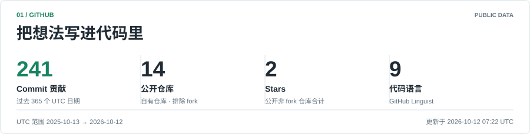
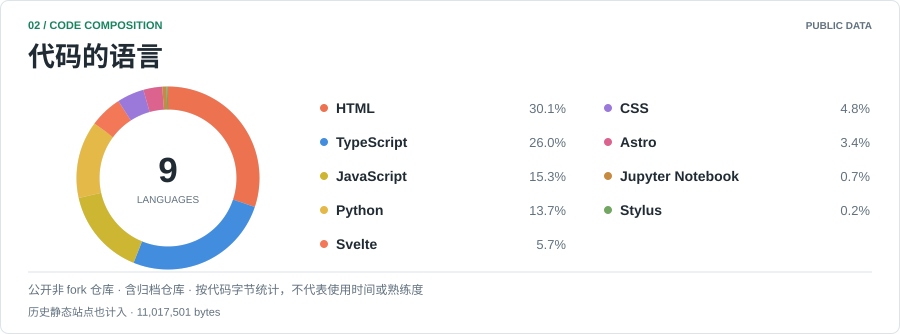
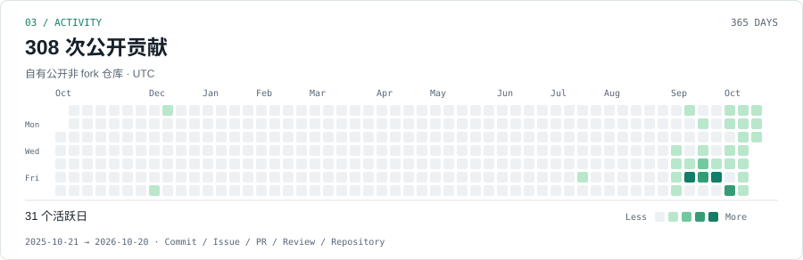
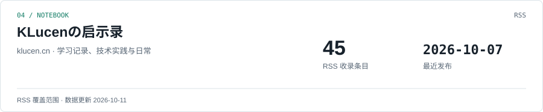
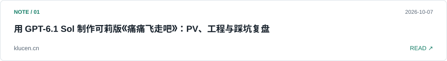
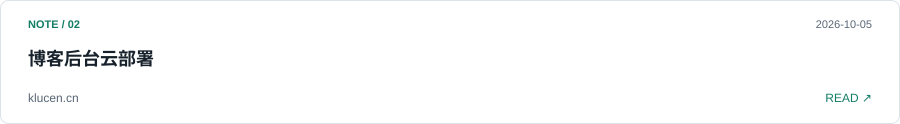

<!-- Generated by scripts/render.mjs. Edit that file to change the profile. -->
# KLucen

AI 学习者，喜欢写代码，也喜欢把实践和思考留在博客里。

<a href="https://www.klucen.cn/" title="博客"><picture><source media="(prefers-color-scheme: dark)" srcset="./assets/link-blog-dark.svg"></picture></a>
<a href="https://github.com/KLucen?tab=repositories" title="仓库"><picture><source media="(prefers-color-scheme: dark)" srcset="./assets/link-repositories-dark.svg"></picture></a>
<a href="https://github.com/KLucen#js-contribution-activity-description" title="贡献"><picture><source media="(prefers-color-scheme: dark)" srcset="./assets/link-contributions-dark.svg"></picture></a>
<a href="https://www.klucen.cn/rss.xml" title="RSS"><picture><source media="(prefers-color-scheme: dark)" srcset="./assets/link-rss-dark.svg"></picture></a>

<a href="https://github.com/KLucen/KLucen/actions/workflows/update-profile.yml" title="查看自动更新记录">
<picture>
  <source media="(prefers-reduced-motion: reduce) and (prefers-color-scheme: dark) and (max-width: 600px)" srcset="./assets/status-static-mobile-dark.svg">
  <source media="(prefers-reduced-motion: reduce) and (max-width: 600px)" srcset="./assets/status-static-mobile-light.svg">
  <source media="(prefers-reduced-motion: reduce) and (prefers-color-scheme: dark)" srcset="./assets/status-static-dark.svg">
  <source media="(prefers-reduced-motion: reduce)" srcset="./assets/status-static-light.svg">
  <source media="(prefers-color-scheme: dark) and (max-width: 600px)" srcset="./assets/status-mobile-dark.svg">
  <source media="(max-width: 600px)" srcset="./assets/status-mobile-light.svg">
  <source media="(prefers-color-scheme: dark)" srcset="./assets/status-dark.svg">
  
</picture>
</a>

<a href="https://github.com/KLucen#js-contribution-activity-description" title="查看 GitHub 贡献">
<picture>
  <source media="(prefers-color-scheme: dark) and (max-width: 600px)" srcset="./assets/overview-mobile-dark.svg">
  <source media="(max-width: 600px)" srcset="./assets/overview-mobile-light.svg">
  <source media="(prefers-color-scheme: dark)" srcset="./assets/overview-dark.svg">
  
</picture>
</a>

<a href="https://github.com/KLucen?tab=repositories" title="浏览公开仓库">
<picture>
  <source media="(prefers-color-scheme: dark) and (max-width: 600px)" srcset="./assets/languages-mobile-dark.svg">
  <source media="(max-width: 600px)" srcset="./assets/languages-mobile-light.svg">
  <source media="(prefers-color-scheme: dark)" srcset="./assets/languages-dark.svg">
  
</picture>
</a>

<a href="https://github.com/KLucen?tab=repositories&amp;q=&amp;type=source&amp;language=HTML" title="HTML"><picture><source media="(prefers-color-scheme: dark)" srcset="./assets/link-language-48544d4c-dark.svg"></picture></a>
<a href="https://github.com/KLucen?tab=repositories&amp;q=&amp;type=source&amp;language=TypeScript" title="TypeScript"><picture><source media="(prefers-color-scheme: dark)" srcset="./assets/link-language-54797065536372697074-dark.svg"></picture></a>
<a href="https://github.com/KLucen?tab=repositories&amp;q=&amp;type=source&amp;language=JavaScript" title="JavaScript"><picture><source media="(prefers-color-scheme: dark)" srcset="./assets/link-language-4a617661536372697074-dark.svg"></picture></a>
<a href="https://github.com/KLucen?tab=repositories&amp;q=&amp;type=source&amp;language=Python" title="Python"><picture><source media="(prefers-color-scheme: dark)" srcset="./assets/link-language-507974686f6e-dark.svg"></picture></a>
<a href="https://github.com/KLucen?tab=repositories&amp;q=&amp;type=source&amp;language=Svelte" title="Svelte"><picture><source media="(prefers-color-scheme: dark)" srcset="./assets/link-language-5376656c7465-dark.svg"></picture></a>
<a href="https://github.com/KLucen?tab=repositories&amp;q=&amp;type=source&amp;language=CSS" title="CSS"><picture><source media="(prefers-color-scheme: dark)" srcset="./assets/link-language-435353-dark.svg"></picture></a>
<a href="https://github.com/KLucen?tab=repositories&amp;q=&amp;type=source&amp;language=Astro" title="Astro"><picture><source media="(prefers-color-scheme: dark)" srcset="./assets/link-language-417374726f-dark.svg"></picture></a>
<a href="https://github.com/KLucen?tab=repositories&amp;q=&amp;type=source&amp;language=Jupyter%20Notebook" title="Jupyter Notebook"><picture><source media="(prefers-color-scheme: dark)" srcset="./assets/link-language-4a757079746572204e6f7465626f6f6b-dark.svg"></picture></a>
<a href="https://github.com/KLucen?tab=repositories&amp;q=&amp;type=source&amp;language=Stylus" title="Stylus"><picture><source media="(prefers-color-scheme: dark)" srcset="./assets/link-language-5374796c7573-dark.svg"></picture></a>

<a href="https://github.com/KLucen#js-contribution-activity-description" title="查看贡献记录">
<picture>
  <source media="(prefers-color-scheme: dark) and (max-width: 600px)" srcset="./assets/activity-mobile-dark.svg">
  <source media="(max-width: 600px)" srcset="./assets/activity-mobile-light.svg">
  <source media="(prefers-color-scheme: dark)" srcset="./assets/activity-dark.svg">
  
</picture>
</a>

<a href="https://github.com/KLucen#js-contribution-activity-description" title="查看贡献记录">
<picture>
  <source media="(prefers-reduced-motion: reduce) and (prefers-color-scheme: dark) and (max-width: 600px)" srcset="./assets/trail-static-mobile-dark.svg">
  <source media="(prefers-reduced-motion: reduce) and (max-width: 600px)" srcset="./assets/trail-static-mobile-light.svg">
  <source media="(prefers-reduced-motion: reduce) and (prefers-color-scheme: dark)" srcset="./assets/trail-static-dark.svg">
  <source media="(prefers-reduced-motion: reduce)" srcset="./assets/trail-static-light.svg">
  <source media="(prefers-color-scheme: dark) and (max-width: 600px)" srcset="./assets/trail-mobile-dark.svg">
  <source media="(max-width: 600px)" srcset="./assets/trail-mobile-light.svg">
  <source media="(prefers-color-scheme: dark)" srcset="./assets/trail-dark.svg">
  
</picture>
</a>

<a href="https://www.klucen.cn/" title="打开博客">
<picture>
  <source media="(prefers-color-scheme: dark) and (max-width: 600px)" srcset="./assets/blog-mobile-dark.svg">
  <source media="(max-width: 600px)" srcset="./assets/blog-mobile-light.svg">
  <source media="(prefers-color-scheme: dark)" srcset="./assets/blog-dark.svg">
  
</picture>
</a>

### 最近写下的

<a href="https://www.klucen.cn/posts/klee-pv-gpt61sol.html/" title="阅读文章：用 GPT-6.1 Sol 制作可莉版《痛痛飞走吧》：PV、工程与踩坑复盘">
<picture>
  <source media="(prefers-color-scheme: dark) and (max-width: 600px)" srcset="./assets/article-1-mobile-dark.svg">
  <source media="(max-width: 600px)" srcset="./assets/article-1-mobile-light.svg">
  <source media="(prefers-color-scheme: dark)" srcset="./assets/article-1-dark.svg">
  
</picture>
</a>

<a href="https://www.klucen.cn/posts/%E7%94%9F%E6%B4%BB/%E5%8D%9A%E5%AE%A2%E5%90%8E%E5%8F%B0%E4%BA%91%E9%83%A8%E7%BD%B2/" title="阅读文章：博客后台云部署">
<picture>
  <source media="(prefers-color-scheme: dark) and (max-width: 600px)" srcset="./assets/article-2-mobile-dark.svg">
  <source media="(max-width: 600px)" srcset="./assets/article-2-mobile-light.svg">
  <source media="(prefers-color-scheme: dark)" srcset="./assets/article-2-dark.svg">
  
</picture>
</a>

<a href="https://www.klucen.cn/posts/88260717.html/" title="阅读文章：博客搬家记：从 Hexo 到 Astro">
<picture>
  <source media="(prefers-color-scheme: dark) and (max-width: 600px)" srcset="./assets/article-3-mobile-dark.svg">
  <source media="(max-width: 600px)" srcset="./assets/article-3-mobile-light.svg">
  <source media="(prefers-color-scheme: dark)" srcset="./assets/article-3-dark.svg">
  
</picture>
</a>

正在探索的项目

- AI 与学习笔记：[ai-agent-book-note](https://github.com/KLucen/ai-agent-book-note)
- Markdown 阅读与批注：[MerMarkd](https://github.com/KLucen/MerMarked)
- 博客与前端实践：[shirone-blog](https://github.com/KLucen/shirone-blog)

数据口径与更新

数据更新时间：2026-10-13（UTC）。卡片由本仓库每日自动生成，无需第三方统计卡片服务。

- 范围为自有公开非 fork 仓库，包含归档仓库；私有仓库和其他人的仓库不计入。
- Commit 统计区间：2025-10-14 至 2026-10-13，遵循 GitHub Commit 贡献的资格规则。
- 贡献日历包含 Commit、Issue、PR、Review 和创建仓库，因此不等于 Commit 数，也不等于 GitHub 全主页贡献数。
- 语言比例来自 GitHub Linguist 识别的代码字节；包含历史静态博客与仓库中的依赖代码，不代表熟练度，也不代表框架使用次数。语言按钮按 GitHub 仓库的主要语言筛选，不等于该语言存在的全部仓库。
- 博客数量为 RSS 中的条目数，未声称覆盖全部文章。
- 状态点表示自动更新计划，不表示在线。像素巡游仅为装饰，播放两轮后停止；系统减少动效模式使用静态图片。
- 采集失败时会显示缓存或缺失状态。更新方式见 [维护说明](./DEVELOPMENT.md)。

